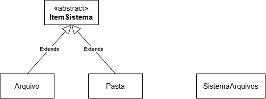

# Sistema de Arquivos — Padrão Composite

## Sobre a atividade

Este projeto implementa o padrão de projeto Composite para representar um sistema de arquivos. A proposta permite organizar arquivos e pastas em uma estrutura hierárquica, na qual uma pasta pode conter arquivos e outras pastas.

## Estrutura das classes

- **ItemSistema:** classe abstrata que define o atributo `nome` e o método abstrato `getEstrutura()`.
- **Arquivo:** representa um arquivo individual e possui o atributo `extensao`.
- **Pasta:** representa um agrupamento de arquivos e outras pastas, utilizando uma lista de elementos do tipo `ItemSistema`.
- **SistemaArquivos:** representa o cliente que recebe a pasta raiz e permite consultar a estrutura completa.

## Funcionamento

A classe `Pasta` armazena elementos do tipo `ItemSistema`, permitindo adicionar tanto objetos `Arquivo` quanto outras `Pasta`. Seu método `getEstrutura()` percorre os elementos e obtém a representação de cada um.

A classe `SistemaArquivos` recebe a pasta principal e utiliza o método `getEstrutura()` para consultar a organização do sistema.

## Testes

Os testes são realizados na classe `SistemaArquivosTest.java`, verificando a criação de arquivos, pastas vazias, adição de elementos e estruturas com pastas aninhadas.

## Diagrama de Classe
